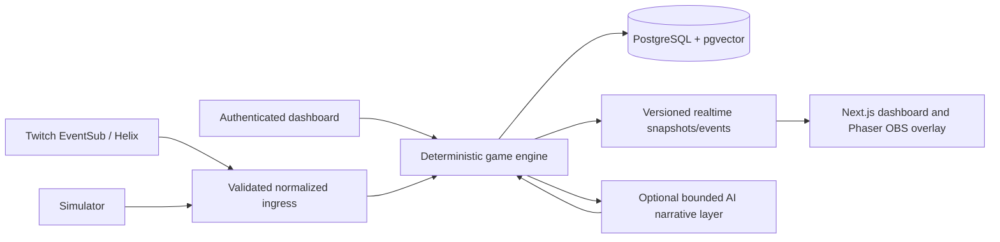

# MythosLive

MythosLive turns a Twitch community into a persistent fantasy party. Viewers join heroes, vote on the party's next move, fight deterministic encounters, and leave a shareable Chronicle. Streamers retain control over pauses, safety settings, and consequential story approvals.

> Screenshots and demo video: add owner-captured images/GIFs here after the documented checks. No production or live-channel media is included in this repository.

## What works today

- Deterministic Emberfall engine, persistence, votes, combat, bosses, riddles, recaps, and event log.
- A simulator that uses the normalized event path, with explicit `[SIM]` labels and no Twitch send path.
- Twitch broadcaster/bot OAuth, EventSub chat/follow/raid ingress, Helix chat outbox, dashboard, and OBS overlay. Actual channel connectivity requires your Twitch app and consent.
- Optional AI narration and scene flavor with deterministic fallbacks. No AI key is required to play.
- Persistent, consent-aware memory and opt-out deletion.
- Follow/raid effects are implemented; subscription, gift, cheer, Channel Points, and native poll integrations are unavailable/disabled.

The landing-page campaign card is illustrative. The judge campaign data is locally seeded; its participants and records are simulated, not real viewers.

## Architecture



## Quickstart

Requirements: Docker Desktop with the Linux engine, Docker Compose v2, and a terminal. No Twitch credentials or LLM key are needed for judge mode. A local encryption key is required for dashboard sessions and token-at-rest support.

1. Copy `.env.example` to `.env`.
2. Generate a Fernet key and paste it into `ENCRYPTION_KEY` without adding quotes:

   ```powershell
   py -3.12 -c "import base64,secrets; print(base64.urlsafe_b64encode(secrets.token_bytes(32)).decode())"
   ```

   This standard-library command encodes 32 cryptographically random bytes in Fernet's URL-safe key format.

3. Start the stack. Compose waits for PostgreSQL health, then backend migrations/API readiness, then frontend:

   ```powershell
   docker compose up --build -d
   docker compose run --rm backend python -m scripts.seed
   ```

4. Open [http://localhost:3000](http://localhost:3000), choose **Try the simulator**, then **Start judge demo** on the local connect screen. This one-click action signs into local simulator mode, starts the session/persona generator, and opens `/sim`. The seed creates three `[SIM]` heroes, a consented sample memory, and two previous Chronicles. The full deterministic CLI campaign is also available with `make sim`.
5. Check [http://localhost:8000/healthz](http://localhost:8000/healthz) and `/readyz`. Backend is port 8000, frontend 3000, PostgreSQL is bound to loopback port 5433. The named PostgreSQL volume persists across normal restarts.

Stop with `docker compose down`; this preserves database data. Do not add `-v` unless you intend to erase Compose volumes. `make test`, `make lint`, `make typecheck`, `make migrate`, `make seed`, and `make sim` are available when GNU Make is installed.

## Environment reference

| Variable | Purpose |
| --- | --- |
| `DATABASE_URL` | Async PostgreSQL URL; Compose default uses `db:5432` internally. |
| `POSTGRES_DB`, `POSTGRES_USER` | Local PostgreSQL database and user. |
| `BUILD_VERSION` | Non-secret build label returned by health/readiness endpoints; defaults to `local`. |
| `ENCRYPTION_KEY` | Required random Fernet key for encrypted tokens and signed local dashboard sessions. |
| `CORS_ORIGINS` | Exact browser origins allowed by the API. |
| `TWITCH_CLIENT_ID`, `TWITCH_CLIENT_SECRET` | Optional Twitch application credentials. |
| `TWITCH_BROADCASTER_REDIRECT_URI`, `TWITCH_BOT_REDIRECT_URI` | Exact callback URLs registered in the Twitch app. |
| `AI_API_BASE_URL`, `AI_API_KEY`, `AI_*_MODEL` | Optional OpenAI-compatible narrative, embedding, and moderation configuration. |
| `EMBEDDING_DIMENSION` | Set only when selecting an embedding model with a fixed vector dimension. |

`.env.example` contains placeholders only. Keep `.env` private. Do not expose the local simulator login on a public deployment.

## Twitch and OBS

See [Twitch setup](docs/twitch-setup.md) for app registration, broadcaster/bot roles, scopes, and troubleshooting. See [OBS setup](docs/obs-setup.md) for transparent Browser Source configuration. The actual Twitch account flow and real channel effects require owner-provided credentials and an authorized test channel; simulator fixtures are not proof of a live Twitch connection.

## Simulator and judge mode

Judge mode needs only the Compose stack and `ENCRYPTION_KEY`. It needs no Twitch account or AI provider. All participants and social-event fixtures in `/sim` are visibly simulated and cannot send to Twitch. Use `docs/judge-quickstart.md` for a clean-clone walkthrough and a complete campaign run.

## Privacy, safety, and assets

Raw chat is not used as long-term memory or exposed on public Chronicle pages. Viewer memory is consent-aware; `!optout` removes personal hero/memory data under the deletion policy in [privacy and memory](docs/privacy-and-memory.md). Chat and generated content are bounded and moderated; deterministic rules own game outcomes. Review [AI safety](docs/ai-safety.md) before enabling an external provider.

No third-party art or sound files are bundled. The Phaser experience uses local procedural/vector placeholders when Kenney packs are absent. Asset pack credits and permitted use are described in [asset credits](docs/asset-credits.md); only add the user-provided CC0 packs locally.

## Release and limitations

This repository is packaged for local development/judging; it has not been deployed. No public URLs, live Twitch acceptance, OBS compositing, or public-origin OAuth/WebSocket checks are claimed. Optional Twitch event families remain disabled. Read [architecture](docs/architecture.md) for implemented boundaries and [codex log](docs/codex-log.md) for tests actually run.
Production deployment configuration and operator checklist: [docs/production-deployment.md](docs/production-deployment.md). The profile has been prepared and Compose configuration validated, but no public deployment or VM changes have been made.

